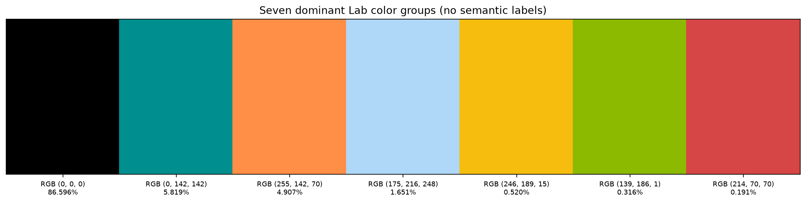

# Dataset Class Mapping Investigation

## Dataset source and documentation

The local archive matches Kaggle's [Floor Plan dataset by AsutoshPrad](https://www.kaggle.com/datasets/asutoshprad/floor-plan-dataset): the page identifies it as an enhanced CVC FPP dataset, lists X and Y, and reports 242 files. The local archive contains 121 X images and 121 Y masks (242 files), with matching numeric IDs and dimensions. This is a strong structural identity match, not a byte-for-byte provenance check.

The Kaggle uploader describes the targets as SVG masks converted to PNG with a custom script and acknowledges the original CVC FPP creators without naming them. Kaggle metadata dates the upload to 2024-10-28 and lists the license as **Unknown**. Its description does not define a class legend, RGB-to-class mapping, or annotation schema. The local dataset contains no non-image metadata or annotation files.

The associated Kaggle notebook [Floor Plan dataset](https://www.kaggle.com/code/liubovcherepanova/notebookf9859148d5) identifies the same Kaggle input but provides no accessible class legend in its page metadata. No unrelated floor-plan datasets were used as mapping evidence.

## Method and representative visual inspection

The seven color groups were fit by OpenCV K-means in CIE Lab space using a deterministic, pixel-area-weighted sample of 1,000,003 pixels (seed 2026). Every exact RGB value found in all Y masks was assigned to its nearest fitted Lab center to calculate the table's pixel frequencies. That assignment is exhaustive given the fitted centers; group boundaries and representative colors remain approximate because of clustering and anti-aliasing.

Each visual sheet shows the original plan, original mask, a color-group overlay, and seven location maps over a dimmed plan. Percentages are measured per mask; the panels are evidence of geometry and color location only, not semantic proof.

A notable cross-pair observation is that large filled interior regions appear teal in pairs 1 and 61 but orange in pairs 31, 91, and 121. Thus a dominant filled-region appearance does not have a stable global RGB identity in these examples; the images may use varying palettes or annotation conventions. This prevents a reliable cross-dataset color-to-class assignment from visual evidence.

- Pair 1: [visual evidence](../visualizations/class_mapping/pair_001_class_evidence.png)
- Pair 31: [visual evidence](../visualizations/class_mapping/pair_031_class_evidence.png)
- Pair 61: [visual evidence](../visualizations/class_mapping/pair_061_class_evidence.png)
- Pair 91: [visual evidence](../visualizations/class_mapping/pair_091_class_evidence.png)
- Pair 121: [visual evidence](../visualizations/class_mapping/pair_121_class_evidence.png)

### Per-pair group coverage

| Pair | G1 | G2 | G3 | G4 | G5 | G6 | G7 |
|---:|---:|---:|---:|---:|---:|---:|---:|
| 1 | 71.28% | 23.71% | 0.31% | 3.61% | 0.84% | 0.11% | 0.13% |
| 31 | 76.40% | 0.14% | 18.60% | 3.41% | 0.86% | 0.58% | 0.00% |
| 61 | 78.74% | 17.26% | 0.14% | 2.44% | 0.29% | 0.89% | 0.25% |
| 91 | 72.20% | 0.18% | 22.17% | 3.85% | 1.16% | 0.43% | 0.00% |
| 121 | 65.57% | 0.00% | 28.94% | 4.77% | 0.53% | 0.19% | 0.00% |

### Dataset-wide groups and class assessment

| Group | Representative RGB | Pixel frequency | Visual observations | Possible interpretation | Evidence source | Confidence | Mapping status |
|---:|---|---:|---|---|---|---|---|
| G1 | `(0, 0, 0)` | 1,380,420,907 px (86.5956%) | Near-black fills most of the canvas outside colored regions; dark plan detail also remains in some areas. | Unpainted background or retained linework; not an architectural object label. | Local paired X/Y PNGs; official Kaggle description confirms rasterized SVG masks but supplies no legend | Low; visual only | **CANDIDATE** |
| G2 | `(0, 142, 142)` | 92,761,299 px (5.8190%) | Broad filled regions in pairs 1 and 61; almost absent in pairs 31, 91, and 121. | A filled-region role is plausible, but its RGB identity is not stable across pairs. | Local paired X/Y PNGs; official Kaggle description confirms rasterized SVG masks but supplies no legend | Low for region role; none for class | **UNKNOWN** |
| G3 | `(255, 142, 70)` | 78,228,783 px (4.9074%) | Broad filled regions in pairs 31, 91, and 121, but only small marks in pair 1. | A filled-region role is plausible, but its RGB identity is not stable across pairs. | Local paired X/Y PNGs; official Kaggle description confirms rasterized SVG masks but supplies no legend | Low for region role; none for class | **UNKNOWN** |
| G4 | `(175, 216, 248)` | 26,312,169 px (1.6506%) | Mostly thin, light outline-like strokes around or within filled regions. | Boundary or outline annotation is possible; not confirmed as walls or another class. | Local paired X/Y PNGs; official Kaggle description confirms rasterized SVG masks but supplies no legend | Low; visual only | **CANDIDATE** |
| G5 | `(246, 189, 15)` | 8,288,975 px (0.5200%) | Short, block-like marks distributed along plan edges and internal locations. | Unidentified marker or annotation; no architectural class is supported. | Local paired X/Y PNGs; official Kaggle description confirms rasterized SVG masks but supplies no legend | None for semantic identity | **UNKNOWN** |
| G6 | `(139, 186, 1)` | 5,039,425 px (0.3161%) | Small isolated blocks or short marks, often near geometry boundaries. | Unidentified marker or annotation; no architectural class is supported. | Local paired X/Y PNGs; official Kaggle description confirms rasterized SVG masks but supplies no legend | None for semantic identity | **UNKNOWN** |
| G7 | `(214, 70, 70)` | 3,048,087 px (0.1912%) | Sparse red line segments inside some plans; absent or negligible in some pairs. | Internal line/mark annotation is possible; no object identity is supported. | Local paired X/Y PNGs; official Kaggle description confirms rasterized SVG masks but supplies no legend | Low; visual only | **CANDIDATE** |

**Confirmed mappings: none.** No color can be reliably identified as a wall, door, window, room, or other architectural class from the available sources. The black group is only a low-confidence background candidate; do not treat it as confirmed. The seven clusters are palette groupings, not evidence that the dataset has seven semantic classes.

## Palette visualization

## Limitations and next step

The Kaggle page does not identify the original CVC FPP authors or expose the SVG annotation schema, and its license is unknown. A visual association is not authoritative documentation. Before implementing semantic mapping or extraction, obtain the original CVC FPP annotation guide/legend or inspect the original SVG layers and verify their IDs against the Kaggle-rendered PNGs. Request permission or clarification from the Kaggle uploader if the original schema is unavailable. Keep room, wall, door, and window extraction paused pending that verification.
